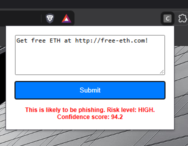

## Instructions to Run
This is a Docker-containerisation project. To run it:
- clone this repo locally
- obtain an access token to Hugging Face model repo by requesting Azeemo99/cryptoguard-models
- add access token to new file in project root named 'hf_token.txt'
- make sure Docker engine is open and running.
- build Docker image with command: docker build --secret id=hf_token,src=hf_token.txt -t cryptoguard-v2 .
- once build has finished, run the container with command: docker run --rm -p 8000:8000 cryptoguard
- open browser and navigate to chrome://extensions and turn on developer mode
- select load unpacked, and select 'extensions' folder from this repo
- open up extension by clicking icon in top right

```
NOTE: The DistilBERT blockchain-adapted model was trained as part of a training and evaluation model, 
where a blockchain data corpus was synthesised and fed to multiple BERT models.
You can find the code for that here: https://github.com/Azeemo99/cryptoguard.git
```

# 1. Manifesto
## 1.1 Project Overview
### 1.1.1 Problem Statement
This project provides extra security for those who are using blockchain networks and are likely to be getting messages from people and want a way to verify whether it is safe to proceed 
with that message. This project provides a free and efficient way to classify any message under 512 tokens with a blockchain-adapted transformer model.

### 1.1.2 User Circumstance
A blockchain currency user in a blockchain messaging setting – e.g. a Discord group focused on blockchain. There, a new user drops a message saying 'Claim your free ETH at http:something'. User is tempted and doesn't
want to miss out on free crypto, but is also aware that there is a chance that this could be a ruse to steal his data. He wants a quick verdict on the risk of clicking on the link provided, and so he uses the browser 
extension – clicking on its icon and putting in the message he received. Within seconds, he gets a classification, a confidence score, and a risk level.

## 1.2 Requirements and Criteria
### 1.2.1 Functional Requirements
- FR-1: It must be able to take in text as input
- FR-2: It must provide the classification as either 'Phishing' or 'Safe'
- FR-3: It must provide a risk level alongside the classification that is one of 'HIGH', 'MEDIUM', or 'LOW'
- FR-4: There must also be a confidence score given for the classification, 0–100

### 1.2.2 Non-Functional Requirements
- NFR-1: It should not read the page content to ensure security
- NFR-2: It should only take one click after putting in text to get a score
- NFR-3: It should handle Docker errors, with a clear error message saying that the network can't be reached, presented below the Submit button
- NFR-4: Any server issues should be handled and a clear error message saying that there is an HTTP error, presented below the Submit button
- NFR-5: It should take no more than six seconds to return a classification after text is inputted
- NFR-6: After running the two commands to build the image and run the container, there should be no more steps for the API to be usable
- NFR-7: The API must not log, store, or transmit the user's inputted text beyond in-memory classification

### 1.2.3 Acceptance Criteria
- FR-1: Input text in the field and click the Submit button, no error message is present. Check DevTools – the request is sent and no error is received from the server
- FR-2: After entering text into the provided field and clicking the Submit button, a classification that is either 'Phishing' or 'Safe' is presented
- FR-3: After entering text into the provided field and clicking the Submit button, a risk level is presented that is one of 'HIGH', 'MEDIUM', and 'LOW'
- FR-4: After entering text into the provided field and clicking the Submit button, a confidence score between 0 and 100 is presented
- NFR-1: Simply opening up the extension and scrolling a text-filled browser page should not cause the classification to trigger
- NFR-2: After inputting text, there is only one interaction required before getting the classification result – we simply click the Submit button and wait, and we get the classification and risk level, as 
well as a confidence score
- NFR-3: Close the Docker engine after loading the extension into the browser. Then we input text and click the Submit button. It does not get stuck, but instead presents 'Error. Could not reach the API. Is Docker 
running?' below the Submit button
- NFR-4: Change code in the predict() route after loading the extension into the browser. Then we input text and click the Submit button. It does not get stuck, but instead 'Error 500. Cannot reach server.' 
is presented below the Submit button.
- NFR-5: After putting text in the field and clicking the Submit button, a classification is returned in no more than 6 seconds
- NFR-6: After copying the repo, we put in command docker build -t cryptoguard . and then docker run -p 8000:8000 cryptoguard, and it runs the container, loading the extension into chrome, where we can use it
- NFR-7: After classifying a message, check the API's stdout/stderr logs and the container filesystem, and none of the pasted messages appear in either

## 1.3 Assumptions and Constraints
### 1.3.1 Assumptions
- The user is on Windows 10+
- The user has Docker installed
- The user's browser is Chrome
- The user has an internet connection when building the image
- A 'HIGH' risk level is a score above 0.8, 'MEDIUM' is above 0.5, and below 0.5 it is 'LOW'
- The model - trained on synthesised data - is accurate enough in classifying blockchain-specific messages

### 1.3.2 Constraints
- The model is fixed – a pre-trained distilbert that can't be re-trained
- The project must be local-only
- Must run on low-end laptops – no GPU required

## 1.4 Scope and Completion
### 1.4.1 In-Scope
- Chrome pop-up extension
- Docker-containerised
- FastAPI serves a pre-trained distilbert model

### 1.4.2 Out-of-Scope
- Deploying to the cloud
- Post-deployment maintenance
- Multi-class classifications
- Availability in extension stores
- Floating pop-up
- Automatic reading of page content
- Staying on the screen

### 1.4.3 Project Completion Check
- The Docker image can be built, and the container can be run, loading the extension into Chrome
- The extension icon can be clicked to make it pop up, where there is an input field and a Submit button
- Text can be pasted into the field and the Submit button can be clicked 
- Within six seconds of clicking Submit, a classification, a risk level, and a confidence score are presented
- There is a README that outlines the motivations and purpose of the project

# 2. Design Overview
## 2.1 Architecture
       +------------------------------------------------------------------------+                                                                                                                                                        
       |                                                                USER PC |                                                                                                                                                        
       |                                                                        |                                                                                                                                                        
       |                     +--------------------------+                       |                                                                                                                                                        
       |                     |     Chrome Browser       |                       |                                                                                                                                                        
       |                     |                          |                       |                                                                                                                                                        
       |                     |                          |                       |                                                                                                                                                        
       |                     | +----------------------+ |                       |                                                                                                                                                        
       |                     | |  Browser Extension   | |                       |                                                                                                                                                        
       |                     | |                      | |                       |                                                                                                                                                        
       |                     | | popup.js  popup.html | |                       |                                                                                                                                                        
       |                     | |                      | |                       |                                                                                                                                                        
       |                     | +----------------------+ |                       |                                                                                                                                                        
       |                     |       |       ^          |                       |                                                                                                                                                        
       |                     +--------------------------+                       |                                                                                                                                                        
       |                             |       |                                  |                                                                                                                                                        
       |                             |       |                                  |                                                                                                                                                        
       |                             |       |                                  |                                                                                                                                                        
       |                             |       |                                  |                                                                                                                                                        
       +-----------------------------|-------|----------------------------------+                                                                                                                                                        
                                     |       |                                                                                                                                                                                           
                                     |       |                                                                                                                                                                                           
                                     |       |                                                                                                                                                                                           
                                     |       |                                                                                                                                                                                           
                                     |       |                                                                                                                                                                                           
                                     |       |                                                                                                                                                                                           
               JSON request (HTTP)   |       |   JSON response                                                                                                                                                                           
                                     |       |                                                                                                                                                                                           
                                     |       |                                                                                                                                                                                           
                                     |       |                                                                                                                                                                                           
                                     |       |                                                                                                                                                                                           
                                     |       |                                                                                                                                                                                           
                                     |       |                                                                                                                                                                                           
                                     |       |                                                                                                                                                                                           
       +-----------------------------|-------|----------------------------------+                                                                                                                                                        
       |                             |       |                DOCKER CONTAINER  |                                                                                                                                                        
       |                             |       |                                  |                                                                                                                                                        
       |                             |       |                                  |                                                                                                                                                        
       |                             |       |                                  |                                                                                                                                                        
       |                             |       |                                  |                                                                                                                                                        
       |                             v       |                                  |                                                                                                                                                        
       |                                                                        |                                                                                                                                                        
       |      +----------------------------------------------------------+      |                                                                                                                                                        
       |      |                   CORS Middleware                        |      |                                                                                                                                                        
       |      |                                                          |      |                                                                                                                                                        
       |      +----------------------------------------------------------+      |                                                                                                                                                        
       |               |                                 ^                      |                                                                                                                                                        
       |               |                                 |                      |                                                                                                                                                        
       |        +------|---------------------------------|----------+           |                                                                                                                                                        
       |        |      |             Pydantic            |          |           |                                                                                                                                                        
       |        |      v                                 |          |           |                                                                                                                                                        
       |        | +--------------+              +---------------+   |           |                                                                                                                                                        
       |        | |PredictRequest|              |PredictResponse|   |           |                                                                                                                                                        
       |        | +--------------+              +---------------+   |           |                                                                                                                                                        
       |        +------|--------------------------------------------+           |                                                                                                                                                        
       |               |                                 ^                      |                                                                                                                                                        
       |               |                                 |                      |                                                                                                                                                        
       |               |                                 | JSON dictionary      |                                                                                                                                                        
       |               |           /api/v1/predict       |                      |                                                                                                                                                        
       |     +---------|---------------------------------|---------------+      |                                                                                                                                                        
       |     |         v                                 |               |      |                                                                                                                                                        
       |     |    Preprocessor                           |               |      |                                                                                                                                                        
       |     |         |                                 |               |      |                                                                                                                                                        
       |     |         |                                 |               |      |                                                                                                                                                        
       |     |         | string                          |               |      |                                                                                                                                                        
       |     |         |                                 |               |      |                                                                                                                                                        
       |     |         |                                 |               |      |                                                                                                                                                        
       |     |  +------|---------------------------------|-----------+   |      |                                                                                                                                                        
       |     |  |      v                                 |CLASSIFIER |   |      |                                                                                                                                                        
       |     |  |  Tokeniser                             |           |   |      |                                                                                                                                                        
       |     |  |      |                                 |           |   |      |                                                                                                                                                        
       |     |  |      |                                 |           |   |      |                                                                                                                                                        
       |     |  |      |                                 |           |   |      |                                                                                                                                                        
       |     |  |      | tensors                         |           |   |      |                                                                                                                                                        
       |     |  |      |                                 |           |   |      |                                                                                                                                                        
       |     |  |      |                                 |           |   |      |                                                                                                                                                        
       |     |  |      |                                 |           |   |      |                                                                                                                                                        
       |     |  |      v                                 |           |   |      |                                                                                                                                                        
       |     |  |  +----------------------------------------------+  |   |      |                                                                                                                                                        
       |     |  |  |                   Model                      |  |   |      |                                                                                                                                                        
       |     |  |  |                                              |  |   |      |                                                                                                                                                        
       |     |  |  +----------------------------------------------+  |   |      |                                                                                                                                                        
       |     |  +----------------------------------------------------+   |      |                                                                                                                                                        
       |     +-----------------------------------------------------------+      |                                                                                                                                                        
       |                                                                        |                                                                                                                                                        
       +------------------------------------------------------------------------+                                                                                                                                                        
                                         |                                                                                                                                                                                               
                                         |                                                                                                                                                                                               
                                         |                                                                                                                                                                                               
                                         |                                                                                                                                                                                               
                                         |                                                                                                                                                                                               
                                         |  Calls (build-time)                                                                                                                                                                           
                                         |                                                                                                                                                                                               
                                         |                                                                                                                                                                                               
                                         |                                                                                                                                                                                               
                                         |                                                                                                                                                                                               
                                         v                                                                                                                                                                                               
                        +----------------------------------+                                                                                                                                                                             
                        |           Hugging Face           |                                                                                                                                                                             
                        |                                  |                                                                                                                                                                             
                        |  Model Weights and Configuration |                                                                                                                                                                             
                        +----------------------------------+                                                                                                                                                                             

### 2.2 API Contract
#### Route Endpoint
```
method: POST
route: /api/v1/predict
description: Classify user input
```

#### Request Schema
```
{
    "text": "string (min length: 1)"
}
```
#### Response Schema (Status 200)
```
{
    "is_phishing": boolean,
    "confidence_score": float,
    "risk_level": "string"
}
```
#### Response Schema (Status 400)
```
{
    "detail": "Invalid input"
}
```
#### Response Schema (Status 422)
```
{
    "detail": [
        {
            "loc": ["body", "text"],
            "msg": "field required",
            "type": "value_error.missing"
        }
    ]
}
```
#### Response Schema (Status 500)
```
{
    "detail": "Prediction failed"
}
```
### 2.3 Delivery Mapping
| Requirement                 | Component              | Implementation                                                                                                                                                                                                |
|-----------------------------|------------------------|---------------------------------------------------------------------------------------------------------------------------------------------------------------------------------------------------------------|
| FR-1: Text Input            | API & Extension        | Pydantic PredictRequest allows for text input, popup.html creates `<textarea>` input field                                                                                                                    |
| FR-2: Classification        | Model & API            | API sends input to clean_text(), then to Classifier.tokeniser and Classifier.predict, which gives logits, which API applies softmax() to, to create probabilities[0][1], which determines is_phishing boolean |
| FR-3: Risk Level            | API                    | probabilities[0][1] >0.8 for 'HIGH', >0.5  for 'MEDIUM', <0.5 for 'LOW' to decide risk level                                                                                                                  |
| FR-4: Confidence Score      | API                    | multiply probabilities[0][1].item() by 100 to give confidence score                                                                                                                                           |
| NFR-1: No Page Reading      | Extension              | manifest.json does not request activeTab, content_scripts.                                                                                                                                                    |
| NFR-2: One-Click Request    | Extension              | In popup.js, as soon as Submit button is clicked, request is sent to the API for classification                                                                                                               |
| NFR-3: Handle Docker Errors | Extension              | popup.js handles error when container is no longer running, with try/catch and sends to pop.html to display message                                                                                           |
| NFR-4: Handle Server Errors | API & Extension        | FastAPI handles error when server can't be reached, and sends back to Extension to display message                                                                                                            |
| NFR-5: Response Time        | API & Model            | DistilBERT model weights are downloaded at build-time, and trained to return classifications within seconds, API logic includes efficient use of async                                                        |
| NFR-6: Command Count        | Docker, API, Extension | Dockerfile is written to download all used resources at build time, and Docker requires only build and run commands before we can load extension using chrome://extensions                                    | 
| NFR-7: No Data Storing      | API, Extension         | API does not have any logic to store data, no database connected. Popup.js also has no storing of data                                                                                                        |

### 2.4 Behaviour
#### Scenario 1: The Happy Path
- User types or pastes in text in the provided field, then clicks Submit.
- popup.js sends this in POST request to API
- Server checks the Origin header and the server's allow_origins list
- uvicorn receives HTTP bytes, parses into headers and body
- FastAPI checks this against PredictRequest schema
- It is passed to clean_text(), which returns a string
- This string is given to an instance of Classifier, where .tokeniser() tokenises it, returning PyTorch tensors
- These tensors are then passed into .predict(), where it passed into the distilBERT model, returning SequenceClassifierOutput
- We use .logits of this object and perform softmax() on it to squash between 0 and 1.
- This is then converted into a float, where we use thresholds of index 1 to give us 'is_phishing' and 'risk_level', and multiply it by 100 to give us a confidence score, placed into a JSON dictionary in shape of PredictResponse schema
- If the request's Origin header was in the allow_origins list, this is then sent back to popup.js with the Access-Control-Allow-Origin header, otherwise it's sent back without the Access-Control-Allow-Origin header
- popup.js parses response and displays it with popup.html

#### Scenario 2: Empty Input
- User clicks Submit without anything written in the field
- popup.js 'if (!text)' triggers, displays error message 'Invalid input'

#### Scenario 3: Missing Field
- User types or pastes text and clicks Submit
- popup.js sends text to API, but with body having a misspelt "text" field
- PredictRequest schema does not match, and FastAPI returns error with code 422 and message "field required"
- popup.js parses this and displays with popup.html

#### Scenario 4: Docker is Offline (Network Error)
- User types or pastes text and clicks Submit
- popup.js sends this in POST request to API
- API is unreachable as Docker is not running
- try/catch in popup.js catches error, displays 'Network Error' with popup.html

#### Scenario 5: Server Crashes
- User types or pastes text and clicks Submit
- popup.js sends this in POST request to API
- Server issue causes termination of execution, FastAPI's exception handler catches this and returns 500 'Internal Server Error' as response
- popup.js parses this and displays with popup.html

## 3. Structure and Layout
```
cryptoguard-v2/
├─ api/
│  ├─ main.py           # FastAPI app, routing, middleware                   
│  ├─ schemas.py        # Pydantic schemas
├─ core/
│  ├─ classifier.py     # Classifier class
│  ├─ preprocessor.py   # Preprocessor class
│  ├─ config.py         # Hugging Face access adresses
├─ scripts/
│  ├─ download_model.py # Model download script
├─ tests/
│  ├─ api.http          # Manual tests
├─ extension/
│  ├─ popup.html        # Extension UI 
│  ├─ popup.js          # Frontend logic
│  ├─ popup.css         # UI Styling   
│  ├─ manifest.json     # Extension configuration
├─ Dockerfile           # Image build script
├─ .gitignore           # Ignored files
├─ README.md            # Project Overview
├─ requirements.txt     # Dependencies
```